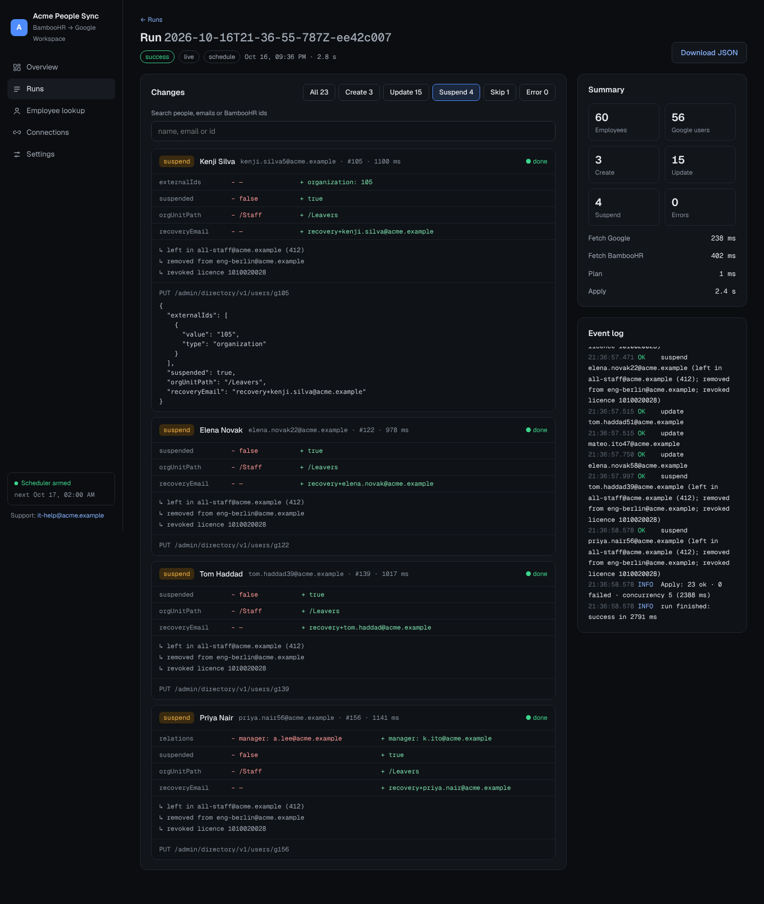

# BambooHR → Google Workspace Sync

Keeps Google Workspace users in line with BambooHR. BambooHR is the source of truth: the service **creates**, **updates** and **suspends** Google users, and comes with a small web UI to preview, run, schedule and configure the sync.

## How it works

Each run is a full reconciliation, not a "changed in the last 24h" diff, so a missed or failed run fixes itself on the next one.

1. Fetch every employee (active, inactive, future hires) from BambooHR in **one** custom-report request.
2. Fetch every Google user in pages of 500.
3. Match employees to users by the BambooHR id stored as the user's `externalIds[type=organization]`, falling back to the work email. Users matched by email get the id stamped on them automatically, so there's no separate "initial setup" command.
4. Build a plan (pure function, unit tested) and apply it with bounded concurrency and retries.

| BambooHR | Google Workspace |
|---|---|
| Active employee with no Google user | **Create** the user with a random password they must change at first login. New users go to the root OU unless you choose another. |
| Field changed (name, title, department, manager, home email, country, custom fields, work email) | **Update** only the fields that changed |
| Employee becomes Inactive | **Suspend** and remove from every group. If configured, also move to a suspended OU, set a `recovery+first.last@` recovery email, and revoke licence SKUs. |
| Employee deleted from BambooHR | **Suspend** the linked Google user (can be turned off) |

Rules:

- Users suspended **and** in a protected OU are never touched.
- Users in a protected OU are never suspended.
- The sync never un-suspends anyone unless *Reactivate suspended users* is on.
- The delegated Google admin is never suspended.

Safety features:

- **Suspension limit**: if a run would suspend more than `MAX_SUSPENSIONS_PER_RUN` users, no one is suspended and the actions show as blocked. This protects against bad source data.
- A run aborts if BambooHR returns no employees.
- Only one run at a time.
- **Slack alerts** when a run fails, has failed actions, or had suspensions blocked by the limit (see below).
- New accounts are only created in domains your Workspace already uses, so stray or sample emails in BambooHR are skipped instead of failing. Set *Managed domains* (`MANAGED_DOMAINS`) to choose the list yourself, for example to add a new secondary domain.
- Retries with exponential backoff on 429/5xx and Google rate-limit 403s, and honours `Retry-After`. BambooHR signals rate limits with 503.

## APIs used

| Purpose | Endpoint |
|---|---|
| All employees | `POST /v1/reports/custom?format=JSON&onlyCurrent=false` ([BambooHR](https://documentation.bamboohr.com/reference/request-custom-report-1)) |
| One employee | `GET /v1/employees/{id}?fields=…` ([BambooHR](https://documentation.bamboohr.com/reference/get-employee)) |
| List / insert / update users | `admin/directory/v1/users` ([Directory API](https://developers.google.com/admin-sdk/directory/reference/rest/v1/users)) |
| User's groups / remove member | `admin/directory/v1/groups?userKey=`, `groups/{g}/members/{m}` |
| Revoke licence | `apps/licensing/v1/product/{p}/sku/{s}/user/{u}` ([Licensing API](https://developers.google.com/admin-sdk/licensing/reference/rest/v1/licenseAssignments/delete)) |

BambooHR has said the custom-report endpoint will eventually be replaced by Datasets. When that happens, only `fetchEmployees` in `src/bamboo.ts` needs to change.

## Setup

**→ Full guide: [docs/SETUP.md](docs/SETUP.md)**. It covers the BambooHR key, the Google service account and delegation (with `gcloud` commands), Docker, systemd and HTTPS, a safe rollout, alerts, a configuration reference and troubleshooting.

Quick start:

```sh
docker build -t bamboohr-gws-sync .
docker run -d -p 3000:3000 -v directory-sync-data:/data -e ENCRYPTION_KEY="<keep this secret>" bamboohr-gws-sync
```

Open http://localhost:3000 and create the admin password. Under **Connections → Credentials**, add the BambooHR key and the Google service account, then press **Preview changes**. A preview shows every change and touches nothing in Google.

### Optional: sync extra fields into Google custom attributes

The mapping is off by default. To copy BambooHR fields (such as division or start date) onto Google users, you need three API names. These are not always the labels you see on screen.

1. **Create the custom attributes in Google.** In the Admin console, go to *Directory → Users → More options → Manage custom attributes → Add custom attribute*. Add a category (for example "Employee Information") and a field for each value you want to sync. Use the *Text* type, or *Date* for dates; BambooHR sends dates as `YYYY-MM-DD`.

2. **Get the Google API names.** The Admin console shows display names. The API uses `schemaName` and `fieldName`, which usually have underscores instead of spaces (`Employee_Information`, `Start_Date`). To see the exact names, open [schemas.list](https://developers.google.com/admin-sdk/directory/reference/rest/v1/schemas/list) and use *Try this method* with `customerId` = `my_customer`, signed in as an admin. The response lists each `schemaName` and its `fields[].fieldName`.

3. **Get the BambooHR field names.** Run this with your API key and subdomain:
   ```sh
   curl -s -u "API_KEY:x" -H "Accept: application/json" \
     "https://api.bamboohr.com/api/gateway.php/SUBDOMAIN/v1/meta/fields"
   ```
   Each field has an `alias` (such as `hireDate` or `division`) and an `id`. Use the alias. If a custom field has no alias, use its numeric `id`. The full list of standard names is in [BambooHR's field reference](https://documentation.bamboohr.com/docs/list-of-field-names).

4. **Enter the mapping.** In *Settings → Custom field mapping*, set the schema name from step 2. Then add one row per field: the Google `fieldName` on the left and the BambooHR alias or id on the right. You can also use `CUSTOM_SCHEMA` and `CUSTOM_FIELDS=Google_Field:bambooField,...` as environment variables.

5. **Preview.** The diff shows each custom field as `schema.field=value`. If Google rejects a name, the error on that action says which one.

## UI

An operations console for the people who run the sync.



- **Overview** shows the sync engine at a glance:
  - KPIs: employee and user counts, % in sync, last run, next scheduled run
  - the last run as a pipeline, with timing per stage (fetch BambooHR, fetch Google, plan, apply)
  - recent runs, live connection health, and the active guardrails
- **Runs** is the full history. Each run shows:
  - every action with a **field-level before/after diff**
  - the exact Directory API request sent (method, path, JSON body; passwords are never stored)
  - suspension clean-up steps (groups left, licences revoked)
  - per-action latency and a timestamped event log, including rate-limit retries

  You can filter and search the actions, apply a preview's changes in one click, and download the run as JSON. Running syncs update live.
- **Employee lookup** previews or applies the sync for one BambooHR employee id.
- **Connections** shows:
  - live round-trips to BambooHR and the Google Directory API, with latency and the raw error when something fails
  - the scheduler's next runs and its timezone
  - which environment variables are set (never their values)
- **Settings** is grouped forms for:
  - branding
  - schedule and guardrails
  - provisioning and offboarding
  - the custom field mapping (add or remove rows)

  Saved to `DATA_DIR/settings.json`; env vars only provide the first defaults.

It follows the OS light/dark preference, works at phone width, and needs no build step (`public/index.html`).

## Security

- **Login.** The console and API use HTTP basic auth. The password is either `UI_PASSWORD` or the one created on first run, stored as an scrypt hash. Until a password exists, only the setup screen is reachable, so create it right after deploying, or set `UI_PASSWORD` up front. Always put the console behind HTTPS when it's reachable from outside your network, since basic auth sends the password with every request.
- **Credentials entered in the console** are encrypted with AES-256-GCM in `DATA_DIR/secrets.enc.json` (file mode 600). They're write-only: the API reports whether each is set and where it came from, never the value. Only the BambooHR subdomain, Google admin and service account email are shown back.
- **The encryption key** is `ENCRYPTION_KEY` if you set it (recommended for production: keep it in your platform's secret store, away from the data volume). Otherwise a random key is generated once into `DATA_DIR/secret.key` (mode 600). That protects against the encrypted file leaking on its own, such as through a copied backup, but not against someone who can read the whole data volume. If the key is lost or changes, the console says so and you re-enter the credentials.
- **Environment variables win.** Anything set in the environment can't be changed or seen from the console.

## Slack alerts

1. In Slack, create an app with an [Incoming Webhook](https://api.slack.com/messaging/webhooks) for the channel that should get alerts.
2. Paste the webhook URL under **Connections → Credentials**, or set `SLACK_WEBHOOK_URL`.
3. Optionally set the console's public URL (Settings → Notifications, or `PUBLIC_URL`), so each alert links to the run.
4. In *Settings → Notifications*, press **Send test**.

By default a message is sent when a run fails, when any action fails, or when suspensions are blocked by the safety limit. This covers scheduled, UI and CLI runs. Choose *After every run* or *Never* in Settings (`NOTIFY_ON`). Alerts are best-effort: a Slack outage never fails the sync, and the outcome is written to the run's event log.

## CLI

```sh
npm run sync                          # dry run of a full sync (reads .env)
npm run sync -- --apply               # apply
npm run sync -- --employee 123        # one employee (add --apply to apply)
```

The process exits non-zero if any action failed, so the CLI also works from cron or a Kubernetes CronJob instead of the built-in scheduler.

## API

| Method | Path | |
|---|---|---|
| GET | `/healthz` | liveness (no auth) |
| GET | `/api/status` | running run, last run, next scheduled run |
| POST | `/api/sync` | `{ "dryRun": true, "employeeId": "123" }` → `202 { id }` (409 if a run is in progress) |
| GET | `/api/runs` · `/api/runs/:id` | history / full run with actions |
| GET | `/api/connections` | live check of BambooHR and Google, with latency |
| GET · PUT | `/api/credentials` | which credentials are set and where from / set (`""` removes) |
| GET · POST | `/api/setup` | first-run admin password (only before one exists) |
| GET · PUT | `/api/settings` | read / update settings (incl. branding) |
| POST | `/api/notifications/test` | send a test message to the Slack webhook |

## Development

```sh
npm run dev        # server with reload
npm test           # planner unit tests + end-to-end edge cases against a simulated BambooHR and Google Workspace
npm run typecheck
```

```
src/
  config.ts   env (secrets) + settings (UI-editable)
  secrets.ts  encrypted credential store, console password hash
  http.ts     fetch with timeout, retry/backoff, concurrency helper
  bamboo.ts   BambooHR client
  google.ts   Directory + Licensing client (service account, domain-wide delegation)
  plan.ts     pure planner: BambooHR + Google state → actions
  sync.ts     executes a plan, suspension cleanup, run history
  notify.ts   Slack alerts for failed runs
  server.ts   Hono API + UI + scheduler
  cli.ts      command line
public/index.html   the UI (no build step)
```

## Scaling notes

- API usage is O(pages), not O(employees): 1 BambooHR call and about N/500 Google list calls per run, plus one write per user that actually changed.
- Unchanged users cost nothing because diffs only compare the fields BambooHR owns.
- Raise `CONCURRENCY` for large tenants. The Directory API quota is per project, and the client backs off automatically.
- Run a single instance, since the run lock is in-process. Use the CLI with an external scheduler if you need something else.

## License

[MIT](LICENSE)
